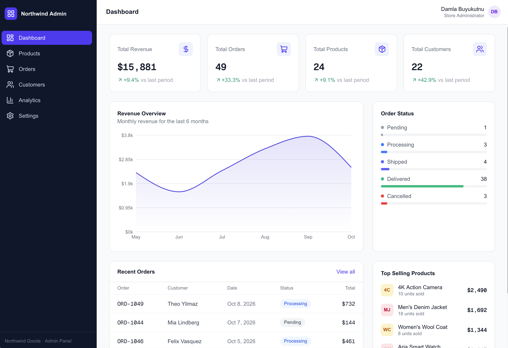
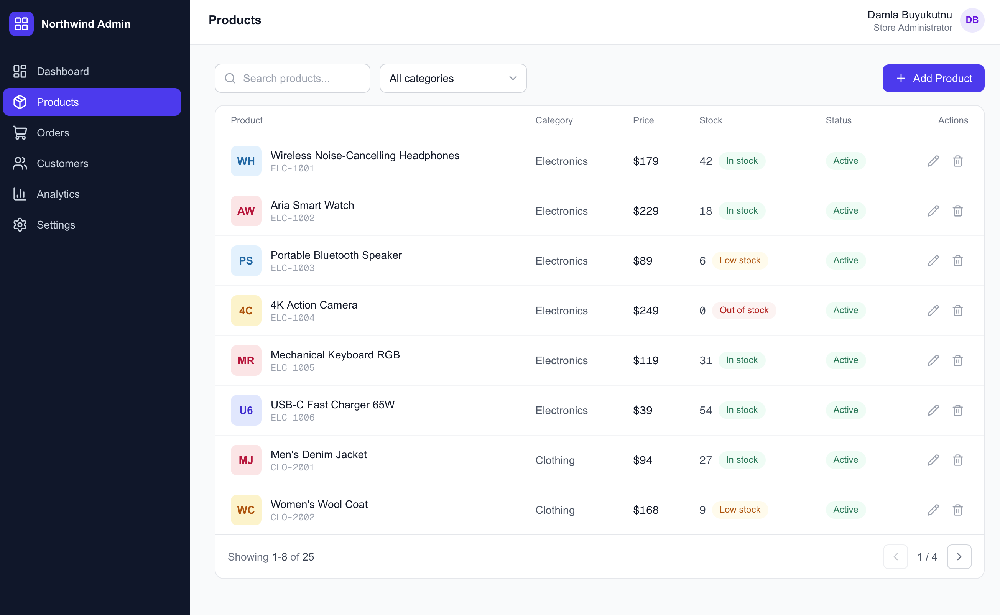
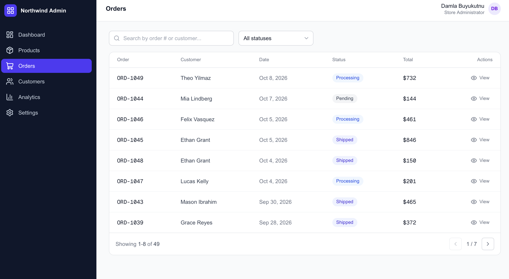
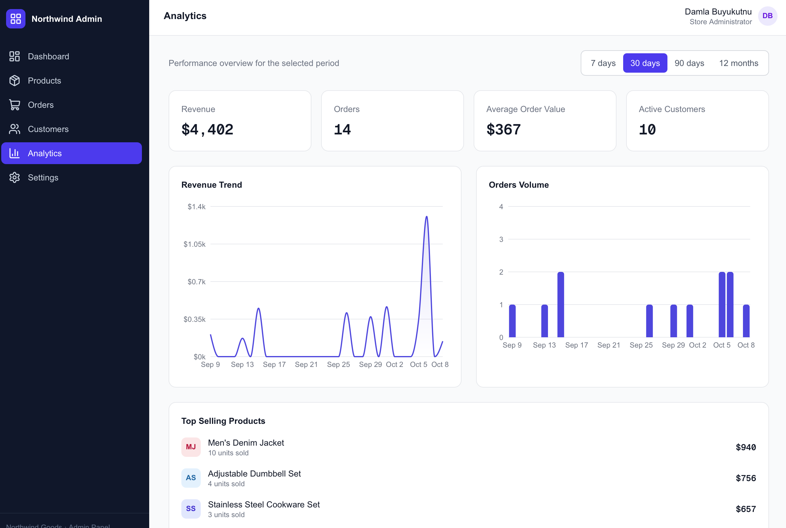

# Northwind Admin — E-commerce Dashboard

A modern, fully interactive e-commerce admin dashboard built as a portfolio project. It demonstrates a realistic SaaS-style admin panel — product catalog management, order tracking, customer insights, and analytics — powered entirely by mock data on the client, with no backend required.

**Live demo:** [ecommerce-dashboard-one-kappa.vercel.app](https://ecommerce-dashboard-one-kappa.vercel.app)

## Screenshots

### Dashboard



### Products



### Orders



### Analytics



## Tech Stack

- [Next.js](https://nextjs.org) (App Router)
- [React](https://react.dev)
- [TypeScript](https://www.typescriptlang.org)
- [Tailwind CSS](https://tailwindcss.com)
- [Recharts](https://recharts.org) for charts
- [Lucide React](https://lucide.dev) for icons

## Features

- **Dashboard** — revenue, orders, products, and customer KPIs with period-over-period change, a monthly revenue chart, recent orders, top-selling products, and an order status breakdown.
- **Products** — searchable, filterable product catalog with stock indicators, and full create / edit / delete flows with validated forms and toast feedback.
- **Orders** — order list with status filtering, a detail view with line items, and inline order status updates.
- **Customers** — searchable customer list with a detail view showing order history and lifetime spend.
- **Analytics** — revenue and order trends across selectable time ranges (7 days, 30 days, 90 days, 12 months) with supporting KPIs.
- **Settings** — editable profile, store information, and interface preferences.

All data mutations (products, order statuses, settings) persist to `localStorage`, so changes survive a page refresh. Search, filtering, pagination, form validation, and delete confirmations are fully functional — this is not a static mockup.

## Getting Started

```bash
npm install
npm run dev
```

Open [http://localhost:3000](http://localhost:3000) in your browser.

### Other scripts

```bash
npm run build   # production build
npm run start   # run the production build locally
npm run lint    # run ESLint
```

## Project Structure

```text
src/
├─ app/           # App Router routes (grouped under (dashboard))
├─ components/
│  ├─ ui/         # Reusable primitives: Button, Modal, Badge, Input, etc.
│  ├─ layout/     # Sidebar, Header, DashboardShell
│  ├─ dashboard/  # Dashboard-specific widgets
│  ├─ products/   # Product table, filters, form modal
│  ├─ orders/     # Order table, filters, detail modal
│  ├─ customers/  # Customer table, detail modal
│  ├─ analytics/  # Analytics charts and controls
│  └─ settings/   # Profile, store, and preference forms
├─ context/       # Client-side app data store (products, orders, customers, settings)
├─ lib/           # Mock data, metrics calculations, formatting, storage helpers
├─ hooks/         # Reusable hooks (pagination, hydration)
└─ types/         # Shared TypeScript types
```

## Deploying to Vercel

1. Push this repository to GitHub.
2. Import the repository on [Vercel](https://vercel.com/new).
3. No environment variables are required — deploy with the default settings.

## Notes

This project uses mock, in-memory data seeded on first load and persisted to `localStorage` afterward. There is no real backend, authentication, or payment processing — it is intended purely as a frontend showcase.
